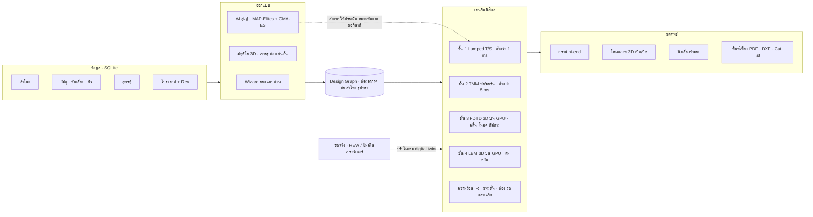

# BASS BUILD — แผนโปรแกรมออกแบบตู้ลำโพง + แล็บฟิสิกส์ 3 มิติ

> ร่างแผน v0.1 · 26 ก.ย. 2026
> สถานะ (3 พ.ย. 2026): **เฟส 0 และเฟส 1 เสร็จ** · แกนฟิสิกส์ครบทุกชนิดตู้ในชั้น 1 รวมลำโพง DVC (ต่อคอยล์อนุกรม/ขนาน/ขดเดียว) และแอมป์เสมือน + สายลำโพง (จุด clipping, กระแสสูงสุด, อิมพีแดนซ์ขาออก) · กราฟดังสุดที่ทำได้ (Max SPL / Max power บอกว่าติดระยะชัก ความร้อน ลมท่อ หรือแอมป์) · เทียบ A/B/C ซ้อนทุกกราฟพร้อมตาราง · ป้ายความเชื่อมั่นทุกตัวเลขและโหมดภาพ · สมุดสูตร (สูตร ค่าที่แทน หน่วย แหล่งอ้างอิง และเขียนสูตรเองได้ด้วยตัวแยกนิพจน์ของเราเอง) · คลังลำโพง (ลำโพงจริง 135 รุ่นจาก datasheet พร้อมลิงก์ที่มา, เพิ่ม/แก้เอง, นำเข้า .wdr/CSV, ส่งออก CSV) · จัดตู้แนะนำ (Butterworth/QB3/Geddes) · วัสดุซับเสียง · Wizard ออกแบบด่วนตามเป้าหมาย 7 แบบ · **เริ่มเฟส 2:** ตรวจตู้ที่สร้างไม่ได้ (ท่อสั้นกว่าแผง/ยาวเกินตู้ ปลายท่อชิดผนัง ตู้เล็กเกินใส่ลำโพงกับแม่เหล็ก) แถบเลื่อนหยุดที่ขอบพร้อมบอกเหตุผล ปุ่มปรับให้สร้างได้ และตู้แนะนำทุกแบบสร้างได้จริง · ลำโพง custom: ขนาดที่วัด 9 ค่า + รูปถ่าย 4 มุม (จิ้มจุดจัดวงกลม/แกน) → โมเดล 3D พาราเมตริกติดรูปจริง · ลิงก์รูปทางการของผู้ผลิต (เก็บเป็นลิงก์ ไม่คัดลอกรูป) · ทรงตู้สี่เหลี่ยมและทรงลิ่ม (หลังเบาะ/ท้ายรถ ผนังหลังเอียง ท่อพับขึ้นตามผนังเอียง ตรวจแม่เหล็กที่ระดับความสูงจริง) · กำหนดขนาดภายนอกทีละด้าน (อัตโนมัติ/กำหนด/ไม่เกิน) ระบบบอกว่าใส่ปริมาตรและลำโพงได้ไหม แถบเลื่อนหยุดที่ขนาดเต็ม และจัดตู้แนะนำให้อยู่ในขนาดนั้น · ปริมาตรสุทธิแยกรายการ (ลำโพง ท่อ แผ่นกั้น โครงค้ำ ที่ว่างเกิน) · ย้อนกลับ/ทำซ้ำ (Ctrl+Z) และบันทึกงานอัตโนมัติในเบราว์เซอร์ · **เฟส 3 แกนหลัก (v0.2.0):** แท็บพิมพ์เขียว รายการตัดทุกแผ่น แบบแต่ละแผ่นพร้อมระยะรูจากขอบ ผังวางบนแผ่นไม้ 1220 × 2440 (MaxRects เผื่อรอยเลื่อย) รายการวัสดุ ขั้นตอนประกอบ พิมพ์/PDF SVG DXF CSV · ทดสอบฟิสิกส์ 41 ข้อ + เว็บ 71 ข้อ + เซิร์ฟเวอร์ 57 ข้อ · ต่อไป: เฟส 2 ส่วนที่เหลือ (ทรงกระบอก/วาดโปรไฟล์ เจาะรู/ท่อ/แผ่นกั้นแบบลากวาง ตัวแปลงรูปทรง→วงจร) และเฟส 3 ส่วนที่เหลือ (รอยต่อบังใบ/เข้ามุม ภาพประกอบทีละขั้น)
> เอกสารนี้ตอบคำถาม "ทำได้แค่ไหน" ก่อนเขียนโค้ดบรรทัดแรก

---

## 0. สรุปสั้น

- **ทำได้เกือบทั้งหมด** แต่ต้องแยกให้ชัดตั้งแต่วันแรกว่าผลไหนแม่นระดับวิศวกรรม และผลไหนเป็นภาพจำลองจากฟิสิกส์จริงที่ความละเอียดจำกัด
  - ทุกตัวเลขและทุกโหมดภาพจะมีป้ายความเชื่อมั่น: 🟢 วิศวกรรม · 🟡 ประมาณเชิงตัวเลข · 🟠 ภาพเชิงปรากฏการณ์
- **หัวใจคือเอนจินฟิสิกส์ 4 ชั้น** ที่อ่านงานออกแบบชุดเดียวกัน (ตารางด้านล่าง)
- **เครื่องของคุณพร้อม:** GTX 1070 Ti 8 GB, Chrome/Edge 153 (รองรับ WebGPU), Node 24, Python 3.12, RAM 32 GB
  - ชั้น 3–4 คำนวณบนการ์ดจอในเครื่องได้เลย ไม่ต้องเช่าคลาวด์
- **ใช้งานจริงได้เร็ว:** จบเฟส 3 ก็เลือกลำโพง → ออกแบบ 3D → ดูกราฟ → พิมพ์แบบไปตัดไม้ได้แล้ว
  - ของว้าว (ควัน/AI) ตามมาเป็นเฟส แต่จะทำต้นแบบควันทดสอบตั้งแต่เฟส 0 เพื่อยืนยันว่าการ์ดจอไหว
- **สิ่งที่ยังไม่มีใครรวมไว้ในโปรแกรมเดียว (เท่าที่ผมทราบ):**
  - ควันและลมจากพลศาสตร์ของไหลจริงแบบเรียลไทม์ในเบราว์เซอร์
  - โซลเวอร์ 4 ชั้นที่ผูกกัน (ลำโพงในโซลเวอร์ 3D ตอบสนองต่อแรงดันในตู้แบบสองทาง)
  - AI แบบ Quality-Diversity ที่หา "ตู้แปลกที่ดีจริง" และทนต่อความคลาดเคลื่อนของลำโพง
  - ปรับโมเดลให้ตรงตู้จริงจากผลวัด (digital twin)
  - พิมพ์เขียวและไฟล์ CNC จากงานออกแบบชุดเดียวกัน

| ชั้น | วิธี | ใช้ทำอะไร | ความเร็ว |
|---|---|---|---|
| 1 | วงจรเทียบ Thiele/Small (lumped) | กราฟทั้งหมดของตู้ทั่วไป | ต่ำกว่า 1 ms — ลากค่าแล้วกราฟเปลี่ยนทันที |
| 2 | คลื่นในท่อ 1 มิติ (Transfer Matrix) | TL, ฮอร์น, ท่อยาว, ทางพับ | ต่ำกว่า 5 ms |
| 3 | สนามคลื่น 3 มิติ (FDTD) บนการ์ดจอ | เห็นคลื่น, ตู้ทรงอิสระ, โหมดตู้, ทิศทางเสียง | สโลว์โมชัน ~30 เท่า (โหมด sine แสดงลื่น 60 fps) |
| 4 | พลศาสตร์ของไหล (Lattice Boltzmann) บนการ์ดจอ | ลม, วอร์เท็กซ์, ควัน | สโลว์โมชัน ~130–400 เท่า |

---

## 1. ทำได้แค่ไหน — ตารางความเป็นไปได้

- ✅ ทำได้ แม่นระดับซอฟต์แวร์มืออาชีพ (เทียบ WinISD / BassBox / Hornresp)
- 🟡 ทำได้ด้วยฟิสิกส์จริง แต่เป็นค่าประมาณหรือความละเอียดจำกัด (บอกบนจอเสมอ)
- 🔴 ทำไม่ได้หรือไม่คุ้ม → มีทางแทน

| # | สิ่งที่ขอ | ผล | ทำได้แค่ไหน / ทางแทน |
|---|---|:-:|---|
| 1 | ตู้ทุกชนิด | ✅ | ตู้ปิด · เบสรีเฟล็กซ์ (ท่อกลม/สลอต/aero) · พาสซีฟเรดิเอเตอร์ · แบนด์พาส 4/6/8 · isobaric · aperiodic · TL/TQWT/MLTL · ฮอร์นหน้า/หลัง · tapped horn · open baffle · ตู้ไฮบริดที่ต่อเอง |
| 2 | ทดสอบเรียลไทม์ตามสูตรแบบแล็บ | ✅ | ลากค่าแล้วกราฟเปลี่ยนทันที · ทุกตัวเลขกดดูสูตร ค่าที่แทน และแหล่งอ้างอิงได้ |
| 3 | ผลทดสอบระดับแอดวานซ์ "ของจริง" | 🟡→✅ | ซิมแม่นเท่าซอฟต์แวร์มืออาชีพ แต่ลำโพงจริงคลาดจาก datasheet ได้ ±15–20% → เพิ่มโหมดวัดจริง (ไมค์ + การ์ดเสียง หรือนำเข้า REW) แล้วปรับโมเดลให้ตรงตู้จริง |
| 4 | 3D เห็นคลื่นเสียง | 🟡 | FDTD บนการ์ดจอ แม่นในย่านเบส–กลาง (ถึงราว 3–7 kHz ตามความละเอียดกริด) |
| 5 | เห็นทิศทางลมไหล | 🟡 | ลูกศรและเส้นกระแสจากสนามความเร็ว 3D · ตัวเลขความเร็วลมในท่อมาจากชั้น 1 (✅) |
| 6 | โหมดควัน ไหลแบบพลศาสตร์ของไหลจริง | 🟡 | LBM แก้สมการของไหลจริง เห็น jet และวงแหวนวอร์เท็กซ์ที่ปากท่อ และควันถูกพ่นออกเมื่อเปิดดัง · ความปั่นป่วนระดับเล็กสุดละเอียดไม่พอในเบราว์เซอร์ → ภาพถูกต้องเชิงปรากฏการณ์ ไม่ใช่ตัวเลข CFD ระดับอุตสาหกรรม |
| 7 | โซนอินฟราเรด | 🟡 | โมเดลความร้อนวอยซ์คอยล์/แม่เหล็ก + power compression แสดงแบบกล้องความร้อน · ลำโพงที่ datasheet ไม่ให้ค่าความร้อนจะใช้ค่าประมาณ |
| 8 | เปิด/ปิดโหมดได้ครบ | ✅ | ทุกโหมดเป็นเลเยอร์อิสระ ซ้อนกันได้ |
| 9 | ความหนาไม้ วัสดุ วัสดุซับเสียง | ✅ | ปริมาตรสุทธิ · ผนังสั่น · เสียงทะลุผนัง · ใยเพิ่มปริมาตรเสมือน · การดูดซับตามความถี่ · น้ำหนักตู้ · ราคาวัสดุ |
| 10 | ฐานข้อมูลลำโพง SQLite | ✅ | เก็บจาก datasheet จริงพร้อมลิงก์ที่มา และตรวจด้วยสูตรสัมพันธ์ · นำเข้าไฟล์ WinISD (.wdr) และ CSV ได้ |
| 11 | สร้างตู้เอง เจาะรูตามต้องการ | ✅ | เจาะตรงไหนก็ได้ โปรแกรมหาเองว่ารูนั้นเชื่อมห้องไหน และทำตัวเป็นรูรั่ว ท่อสั้น หรือทางยาว แล้วคำนวณทันที · ทรงประหลาดสุดขั้วใช้ FDTD ยืนยัน (ใช้เวลาเป็นวินาที) |
| 12 | ใส่สเปค + รูปลำโพง → ใส่ในตู้ทันที | ✅ | สร้างโมเดลลำโพง 3D ตามขนาดจริงจากสเปค แล้วติดรูปถ่ายเป็นผิว · ปั้น 3D จากรูปอย่างเดียว = 🟡 สวยแต่ขนาดไม่จริง |
| 13 | AI สุ่มตู้แปลกที่เสียงดี | ✅ | อัลกอริทึมวิวัฒนาการ + MAP-Elites โดยให้ฟิสิกส์ตัดสินทุกแบบ (AI ไม่เดาตัวเลขเอง) |
| 14 | พิมพ์เขียวมืออาชีพพร้อมรุ่น | ✅ | PDF A4/A3 หลายหน้า · cut list · วางแผ่นไม้ · BOM · DXF สำหรับ CNC/เลเซอร์ |
| 15 | เจนภาพจาก ChatGPT ตกแต่ง UI และเทกซ์เจอร์ | ✅ | วิธีเดิม (ChatGPT ในเบราว์เซอร์ที่ล็อกอินไว้) แล้วแปลงเป็นเทกซ์เจอร์ต่อกันไร้รอยพร้อม normal/roughness map |
| 16 | เว็บ full 3D กราฟ hi-end | ✅ | Three.js WebGPU + PBR + post-processing · กราฟลื่น 60 fps |
| 17 | คลื่น 3D ทุกย่านเสียง ทั้งห้อง แบบเรียลไทม์ | 🔴 | ต้องใช้เซลล์หลายพันล้าน → ทางแทน: 3D ในย่านเบส–กลาง และใช้สูตรวิเคราะห์ (piston + diffraction ขอบตู้) ในย่านแหลม |

---

## 2. ฟังก์ชันครบชุดที่ควรมี

### A. คลังข้อมูล (Library)
- **ลำโพง**
  - ค้นหา/กรองตามขนาด ยี่ห้อ ประเภท (ซับ, วูฟเฟอร์, เสียงกลาง, ฟูลเรนจ์, PA)
  - ค่า T/S ครบ: Fs, Qts, Qes, Qms, Vas, Re, Le, Bl, Mms, Cms, Rms, Sd, Xmax, Xmech, Pe, ความไว, อิมพีแดนซ์, SVC/DVC
  - มิติติดตั้ง: รูเจาะ, ขนาดนอก, ความลึก, ปริมาตรแทนที่, ขนาดแม่เหล็ก
  - ค่าความร้อน (Rth, ค่าคงที่เวลา) ถ้ามี
  - ที่มาของข้อมูล (datasheet / วัดเอง / ผู้ใช้กรอก / ประมาณ) และสถานะตรวจแล้ว
  - **เติมค่าที่ขาดให้อัตโนมัติ** จากสูตรสัมพันธ์ เช่น Qts = Qes·Qms/(Qes+Qms), Vas = ρc²·Sd²·Cms, Fs = 1/(2π√(Mms·Cms)) และเตือนเมื่อค่าขัดกันเอง
  - ตัวบ่งชี้ว่าเหมาะกับตู้แบบไหน (EBP = Fs/Qes, Qts)
  - นำเข้า WinISD (.wdr), CSV หรืออ่านจากรูป datasheet
- **วัสดุแผ่น:** MDF, HDF, ไม้อัด (ธรรมดา/เบิร์ช/marine), ปาร์ติเคิลบอร์ด, ไม้ยางพารา, สัก, ไม้เนื้อแข็ง, อะคริลิก, อลูมิเนียม, เหล็ก, คอนกรีต, คาร์บอน/ไฟเบอร์กลาส, พลาสติกพิมพ์ 3D
  - ค่าที่เก็บ: ความหนาแน่น, โมดูลัสยืดหยุ่น (สองทิศสำหรับไม้อัด), อัตราส่วน Poisson, loss factor, ความหนามาตรฐาน, ขนาดแผ่น (1220×2440 มม.), ราคา
- **วัสดุซับเสียง:** ใยโพลีเอสเตอร์, ใยขนสัตว์, ใยแก้ว, ร็อควูล, ฟองน้ำเมลามีน/PU, สักหลาด, แผ่นซับแรงสั่น (บิวทิล/บิทูเมน)
  - ค่าที่เก็บ: flow resistivity, ความพรุน, ความหนาแน่น, อัตรายัดแนะนำ (กรัม/ลิตร), ราคา
- **ผิวตกแต่ง:** วีเนียร์ไม้, เปียโนแบล็ก, สีพ่น, คาร์บอน, พรมรถยนต์, หนัง/tolex, ผ้าหน้าตู้, ตะแกรงเหล็ก
- **อุปกรณ์:** ท่อ PVC ขนาดมาตรฐาน (ใช้ทำท่อพอร์ต), ท่อพอร์ตสำเร็จรูป, ขั้วต่อ, สกรู, ยางกันรั่ว
- **สูตรตู้ (Recipes):** แม่แบบพร้อมใช้ (Butterworth Qtc 0.707, QB3, SBB4, EBS, BP6, TQWT, tapped horn ฯลฯ) และสูตรที่ผู้ใช้บันทึกเอง แชร์เป็นไฟล์ได้

### B. ออกแบบด่วน (Wizard)
- เลือกลำโพง → เลือกเป้าหมาย (เบสลึก / ดังสุด / ตู้เล็ก / SQ / SPL แข่ง / กลางแจ้ง / ในรถ)
- ได้ตู้แนะนำ 3–6 แบบพร้อมกราฟเทียบกัน → กดเปิดในสตูดิโอ 3D

### C. สตูดิโอ 3D (ออกแบบ)
- **ทรงตู้:** สี่เหลี่ยม, คางหมู/ลิ่ม (ท้ายรถ), กระบอก, ทรงกลม, พีระมิด, วาดโปรไฟล์ 2D แล้วดันเป็น 3D (สำหรับตู้พับและฮอร์น)
- **ผนังหนาจริง** ตามวัสดุ · สลับกรอกขนาดภายนอก/ภายใน · รอยต่อ (ชนตรง, บังใบ, เข้ามุม 45°)
- **เจาะรู:** ลำโพง (ขนาดรูจาก DB), ท่อกลมขอบบาน, ท่อสลอต (ใช้ผนังตู้เป็นผนังท่อ), aero port, PR, ขั้วต่อ, มือจับ, รูรูปทรงอิสระ
  - ลากวางบนผิว มี snap และบอกระยะจากขอบ
- **ภายใน:** แผ่นกั้นห้อง (แบนด์พาส), ทางพับ (TL/ฮอร์น), โครงค้ำ (window brace, dowel), โซนยัดใยหรือบุฟองน้ำ
- **ตัวแปลงรูปทรง → วงจรอัตโนมัติ:** หาห้องอากาศและรูที่เชื่อมกัน แล้วตัดสินว่าแต่ละรูเป็นรูรั่ว ท่อสั้น หรือทางยาว (ส่งให้ชั้น 2)
- **ปริมาตรสุทธิแยกรายการ:** ปริมาตรรวม − ลำโพง − ท่อ − โครงค้ำ ± ผลของใย
- **ตรวจชนและระยะ:**
  - แม่เหล็กห่างผนังหลังพอไหม
  - ปลายท่อห่างผนังอย่างน้อยเท่าเส้นผ่านศูนย์กลางท่อไหม
  - ลำโพงชนกันไหม
  - ตู้ใหญ่เกินพื้นที่ติดตั้งไหม (เช่น ท้ายรถ)
- **ลำโพงหลายตัว:** หน้า/หลัง/ยิงลง/กลับหัว/push-pull · ต่อสายอนุกรม/ขนาน · DVC
- **สร้างลำโพงเอง:**
  - กรอกสเปคและขนาด → ได้โมเดล 3D พาราเมตริก (กรวย, ขอบยาง, ฝาครอบ, โครง, แม่เหล็ก)
  - ใส่รูปถ่ายด้านหน้า/ข้างให้ติดเป็นผิว (จัดวงกลมให้ตรงด้วย 3 จุด หรือให้ตรวจจับอัตโนมัติ)
- **วัสดุและผิวแบบ PBR** เปลี่ยนได้ทันที · ทรงแปลกก็ติดผิวได้ด้วย triplanar (ไม่ต้องคลี่ UV)
- **น้ำหนักตู้และราคาวัสดุ** โดยประมาณ
- **ทั่วไป:** Undo/redo · ประวัติเวอร์ชัน · บันทึกอัตโนมัติ · หน่วย มม./ซม./นิ้ว และ ลิตร/ฟุต³

### D. แล็บทดสอบ
- **เครื่องกำเนิดสัญญาณ:** sine (หมุนความถี่สด), sweep, pink noise, burst, เพลง
- **แอมป์เสมือน:** กำลัง/แรงดัน, อิมพีแดนซ์ขาออก, จุด clipping
- **ไมค์เสมือน** วางได้ทุกจุด: หน้าตู้ 1 ม., ปากท่อ, ตำแหน่งคนขับในรถ, กลางห้อง
- **กราฟ:**
  - SPL (หลายเส้นซ้อน + เส้นเป้าหมาย) · อิมพีแดนซ์ + เฟส
  - ระยะชัก (เทียบ Xmax/Xmech) · ความเร็วลมในท่อ (เทียบเกณฑ์เสียงลม)
  - group delay (เทียบเกณฑ์ที่หูได้ยิน) · เฟส
  - Max SPL และ Max power ตามข้อจำกัด (ระยะชัก/ความร้อน/ลม/แอมป์)
  - step/impulse · waterfall 3D · polar map · balloon 3D
  - อุณหภูมิตามเวลา · power compression · ความดันในตู้ · สเปกตรัมผนังสั่น · ความถี่โหมดตู้
- **โหมดภาพ 3D เปิด/ปิดอิสระ:**
  - คลื่นความดัน · ลูกศรความเร็วลม · เส้นกระแส · ควัน · อินฟราเรด
  - ผนังสั่น · standing wave (โหมดตู้) · ทิศทางเสียง (balloon)
  - เอ็กซเรย์โปร่งใส · ผ่าครึ่ง · ระยะ/ขนาด · กริด
- **ควบคุมเวลา:** เล่น/หยุด/ทีละเฟรม/สโลว์โมชัน ×1–×1000
- **สภาพแวดล้อม:** ห้องไร้เสียงสะท้อน (anechoic) · ห้องนั่งเล่นปรับขนาดได้ · ในรถ (เก๋ง/กระบะแคป/กระบะ 4 ประตู/SUV) · กลางแจ้ง/เวที
- **ชุดทดสอบสำเร็จรูป:**
  - ทดสอบระยะชัก · ทดสอบเสียงลม
  - ทดสอบความร้อน (เปิด X วัตต์ นาน Y นาที)
  - ล่าเรโซแนนซ์ผนัง · ทดสอบรูรั่ว (QL) · หาปริมาณใยที่ดีที่สุด
- **สมุดสูตร:** กดตัวเลขใดก็เห็นสูตร ค่าที่แทน หน่วย และแหล่งอ้างอิง · เขียนสูตรเองได้โดยใช้ตัวแปรจากงานออกแบบ
- **คะแนนการออกแบบ (radar):** ความลึกเบส · ความดัง · ความเรียบ · transient · ความปลอดภัยลำโพง · เสียงลม · ความยากในการสร้าง

### E. AI สุ่มตู้ → หัวข้อ 4

### F. พิมพ์เขียวและส่งออก → หัวข้อ 8

### G. วัดจริงและฟังเสียง
- **นำเข้าผลวัด:** REW/ARTA (.frd, .zma, .txt) และไฟล์คาลิเบรตไมค์
- **วัดในเบราว์เซอร์:**
  - log sweep (วิธี Farina) → ผลตอบสนอง, เฟส, THD
  - วิธี near-field (Keele): วัดเบสที่บ้านได้โดยไม่ต้องมีห้องไร้เสียงสะท้อน
- **วัดอิมพีแดนซ์** ด้วยจิ๊กตัวต้านทาน + การ์ดเสียง 2 ช่อง → หาค่า T/S เอง (added mass / known volume)
- **Digital twin:** ปรับ QL, ผลของใย และ end correction จนกราฟจำลองซ้อนทับผลวัดจริง
- **ฟังเสียงจำลอง:**
  - เล่นเพลงผ่านผลตอบสนองของตู้ พร้อมเสียงลมท่อเมื่อความเร็วเกินเกณฑ์
  - สลับ A/B เพื่อเปรียบเทียบ (ลำโพงหรือหูฟังของผู้ฟังเล่นเบสลึกได้จำกัด)

### H. ระบบทั่วไป
- ภาษาไทยเป็นหลัก สลับอังกฤษได้
- ธีมมืด hi-end · คีย์ลัด
- ระดับกราฟิก Eco / Balanced / Ultra ตรวจการ์ดจออัตโนมัติ
- ไฟล์โปรเจกต์ `.bassbuild` สำหรับแชร์และสำรอง
- เรนเดอร์ภาพ/วิดีโอหมุนโชว์ตู้ (turntable) ส่งออก PNG/WebM

---

## 3. เอนจินฟิสิกส์ (รายละเอียด)

### ชั้น 1 — วงจรเทียบ (Lumped: Thiele/Small + Small + Beranek)
- วงจร 3 โดเมนต่อกัน:
  - **ไฟฟ้า:** แอมป์, สาย, Re, คอยล์แบบ LR-2 (อิมพีแดนซ์ช่วงสูงแม่นกว่า Le ตัวเดียว)
  - **กล:** Bl, Mms, Cms, Rms
  - **อะคูสติก:** Sd, ห้องอากาศ Cab = Vb/(ρc²), ท่อ Map = ρ(L+Δ)/Sp (Δ = end correction), ความสูญเสีย QL/QA/QP, PR, อิมพีแดนซ์การแผ่เสียงของลูกสูบ
- แก้ด้วย **Modified Nodal Analysis** ค่าเชิงซ้อน ~400 จุดความถี่ (5 Hz–20 kHz) → ต่ำกว่า 1 ms
- **netlist กลางชุดเดียว:** ตู้ทรงไหนก็เป็น "กราฟของห้องอากาศ + ท่อ + ลำโพง" ได้ และเป็นฐานของ AI สุ่มตู้
- **ส่วนแอดวานซ์:**
  - ท่อบีบอัดเมื่อลมแรง (ความต้านทานไม่เชิงเส้นตาม |u|)
  - ใยทำให้ปริมาตรเสมือนโตขึ้น (ทฤษฎีสูงสุด ~40%, ใช้จริง ~10–25%)
  - ผนังยืดหยุ่น
  - รวมเสียงจากหลายแหล่งตามตำแหน่งจริง (กรวย + ปากท่อ + PR)
  - ไม่เชิงเส้นสัญญาณใหญ่ Bl(x)/Kms(x)/Le(x) → THD (เมื่อมีข้อมูล)
- **ตรวจกับสูตรปิด:** ตู้ปิด fc = Fs·√(1+Vas/Vb), Qtc = Qts·√(1+Vas/Vb) · ตู้เปิดเทียบตาราง alignment ของ Thiele/Small

### ชั้น 2 — คลื่นในท่อ 1 มิติ (Transfer Matrix Method)
- แต่ละช่วงท่อเป็นเมทริกซ์ ABCD 2×2
  - ทรง: กระบอก, กรวย (คลื่นทรงกลม), exponential/hyperbolic (สมการ Webster)
  - ความสูญเสียผนัง (viscothermal)
  - ช่วงที่ยัดใยใช้โมเดลจาก flow resistivity (Delany-Bazley-Miki / Johnson-Champoux-Allard)
- ต่อเข้า MNA ตัวเดียวกัน (แปลง ABCD → Y-parameter)
  - รองรับ TL ที่ลำโพงอยู่กลางท่อ (offset), ฮอร์นพับ, tapped horn, ฮอร์นที่มีห้องหลัง
- อิมพีแดนซ์ปากฮอร์น/ปากท่อ: ลูกสูบบนแผ่นกั้นอนันต์ หรือท่อปลายเปิด (Levine–Schwinger)
- ตรวจกับ Hornresp (ฟรี) ให้คลาดไม่เกิน ~0.5 dB ในกรณีเดียวกัน

### ชั้น 3 — สนามคลื่น 3 มิติ (FDTD บน WebGPU)
- สมการคลื่นแบบ p–v บนกริดสลับ (Yee):
  - ∂p/∂t = −ρc²·∇·v
  - ∂v/∂t = −∇p/ρ − (σ/ρ)·v — เทอม σ (flow resistivity) จำลองใยในตู้แบบ 3D ได้ตรง ๆ
- ผนังแข็งมาจาก voxel ของโมเดล 3D · ขอบเขตดูดกลืน (PML) สำหรับพื้นที่เปิด
- **ลำโพงผูกสองทาง:** แรงดันหน้า-หลังกรวยป้อนกลับเข้าสมการลำโพงทุกขั้นเวลา → ตู้ทรงอิสระแค่ไหนก็หาผลตอบสนองได้โดยไม่ต้องเดาวงจร
- **ผลลัพธ์:**
  - ภาพคลื่นเคลื่อนไหว (แผ่นตัด / ปริมาตร / ผิวความดันเท่ากัน)
  - ไมค์เสมือน → FFT → กราฟ
  - โหมดตู้และรูปร่างโหมด
  - ทิศทางเสียงระยะไกล (Kirchhoff–Helmholtz)
  - ห้องและในรถในย่านเบส
- **ภาพลื่น 60 fps เมื่อป้อน sine:** พอเข้าสภาวะคงตัวแล้วแสดงแบบหมุนเฟส
- **ประมาณการบน GTX 1070 Ti** (ยืนยันจริงในเฟส 0):
  - กริด 128³ (~2 ล้านเซลล์) ≈ 2,000+ ขั้น/วินาที
  - ความละเอียด 1 ซม. แม่นถึง ~3 kHz · 5 มม. ถึง ~6–7 kHz
  - ที่ 1 ซม. ขั้นเวลา ≈ 16.8 µs → คลื่น 50 Hz หนึ่งรอบใช้ ~0.6 วินาที (ช้าลง ~30 เท่า)

### ชั้น 4 — ลมและควัน (Lattice Boltzmann บน WebGPU)
- D3Q19 + LES (Smagorinsky) + collision แบบเสถียร (TRT/regularized)
  - แก้ Navier–Stokes แบบอัดตัวได้เล็กน้อย → เห็นทั้งคลื่นและการไหลในโซลเวอร์เดียว
- **สิ่งที่จะเห็นจริง:**
  - ลมเข้า-ออกท่อ · jet ที่ปากท่อ · วงแหวนวอร์เท็กซ์
  - ขอบท่อคมกับท่อบาน (flare) ต่างกันชัด
  - ควันถูกพ่นออกจากท่อเมื่อเปิดดัง (net streaming)
- **ควัน:**
  - "ปืนปล่อยควัน" คลิกวางจุดไหนก็ได้
  - อนุภาค 1–4 ล้านตัวลอยตามสนามความเร็ว
  - ความหนาแน่นแบบปริมาตร เรนเดอร์ ray-march มีแสงเงา
- **โหมดซูมปากท่อ (hybrid):** ใช้ความดันในตู้จากชั้น 1 เป็นแรงขับ แล้วจำลองละเอียดเฉพาะรอบท่อ → ละเอียดขึ้นหลายเท่า
- **กรวยลำโพง** ขยับน้อยกว่าขนาดเซลล์ → ใช้เงื่อนไขผนังเคลื่อนที่ (moving-wall bounce-back) ได้แม่น
- **ข้อจำกัดตรง ๆ:** ลมในท่อจริงมี Reynolds ~10⁴–10⁵ (ปั่นป่วน) ความละเอียดในเบราว์เซอร์จับทุกวนไม่ได้
  - ภาพจึงถูกต้องเชิงปรากฏการณ์
  - ตัวเลขความเร็วลมและเกณฑ์เสียงลมใช้ชั้น 1 ที่ตรวจแล้ว
- **ประมาณการ:**
  - ขั้นเวลาผูกกับขนาดเซลล์: ที่ 5 มม. ≈ 8.4 µs (สโลว์โมชันจึงหลีกเลี่ยงไม่ได้)
  - ~1.5 ล้านเซลล์ ≈ 300–900 ขั้น/วินาที
  - คลื่น 40 Hz หนึ่งรอบ ≈ 3–10 วินาที (สโลว์ ~130–400 เท่า) เหมือนกล้องสโลว์โมชันถ่ายควันในแล็บ

### เสริม — ความร้อน / อินฟราเรด
- โครงข่ายความร้อน 2–3 จุด: วอยซ์คอยล์ ↔ แม่เหล็ก/โครง ↔ อากาศ
  - ค่าคงที่เวลาตั้งแต่ไม่กี่วินาทีถึงหลายนาที
- Re(T) = Re₀·(1 + 0.00393·ΔT) (ทองแดง) → ความดังลดลงเมื่อคอยล์ร้อน (power compression) ป้อนกลับเข้ากราฟ SPL เรียลไทม์
- แสดงแบบกล้องอินฟราเรดบนโมเดล 3D + กราฟอุณหภูมิตามเวลา + เตือนเมื่อเกินพิกัดคอยล์

### เสริม — ผนังตู้
- ความถี่ธรรมชาติของแผ่น (ทฤษฎีแผ่นบาง Kirchhoff) ตามวัสดุ ความหนา ขนาด และขอบยึด
  - โครงค้ำแบ่งแผ่นย่อยแล้วคำนวณใหม่
- ภาพโหมดสั่นเคลื่อนไหว + บอก "จุดควรใส่โครงค้ำ"
- เสียงทะลุผนัง: mass law + ความถี่ coincidence (เช่น MDF 18 มม. ≈ 1.5 kHz)

### เสริม — สภาพแวดล้อม
- 4π / 2π / มุมห้อง
- โหมดห้อง + แผนที่ตำแหน่งวางซับ
- ในรถ: cabin gain (+12 dB/octave ใต้โหมดแรกของห้องโดยสาร) ตามขนาดรถ
- กลางแจ้ง: กฎกำลังสองผกผัน + การดูดกลืนของอากาศ (ISO 9613-1) + สะท้อนพื้น

---

## 4. AI สุ่มตู้ (Generative Design)

**หลักคิด: AI เสนอ → ฟิสิกส์ตัดสิน** ทุกตู้ที่โชว์ผ่านการคำนวณจริงแล้ว ไม่มีตัวเลขเดา

1. **รับโจทย์:** ลำโพง, ขนาดภายนอกสูงสุด, วัสดุ, ความยากในการสร้าง, เป้าหมาย (F3, ความเรียบ, dB สูงสุดที่ X วัตต์, group delay, ความเร็วลม), สภาพแวดล้อม, สไลเดอร์ "ความแปลก"
2. **ไวยากรณ์ตู้ (topology grammar):** ต่อห้อง ท่อ ลำโพง ฮอร์นเป็นกราฟ แล้วกลายพันธุ์ได้ (เพิ่มห้อง, เพิ่มท่อ, เปลี่ยนการพับ, ผสมแบบ)
3. **ค้นหาค่า:** CMA-ES (ค่าต่อเนื่อง) + NSGA-II (หลายเป้าหมาย → กราฟ Pareto ขนาด–ความลึกเบส–ความดัง)
4. **MAP-Elites (Quality-Diversity):** ได้ตาราง "ตู้ที่ดีที่สุดของแต่ละแนว" — ตัวนี้คือเครื่องผลิต "ตู้แปลกที่เสียงดี" โดยตรง
5. **สร้างรูปทรงจริง:**
   - พับ TL/ฮอร์นให้ลงกล่อง (serpentine, U-fold, ก้นหอย)
   - ตรวจว่าสร้างได้จริง (จำนวนแผ่น, มุม, ช่องแคบสุด)
   - คำนวณปริมาตรจากรูปทรงจริงแล้วจำลองซ้ำ
6. **ทดสอบความทน:** สุ่มค่าลำโพงคลาดเคลื่อน ±15% (Monte Carlo) แล้วเลือกตู้ที่ยังดีแม้ลำโพงจริงไม่ตรง datasheet
7. **อธิบายเป็นภาษาไทยจากตัวเลขฟิสิกส์** (ทำไมเสียงดี, ข้อควรระวัง) และตั้งรหัสรุ่นให้

- **ความเร็ว:** ประเมินได้หลายพันถึงหมื่นแบบต่อวินาที (Web Workers 6 คอร์) → รอบละไม่กี่วินาทีถึงนาที
- **ผลลัพธ์:** แกลเลอรีการ์ด (ภาพ 3D + ตัวเลขหลัก + radar) · กราฟ Pareto · ปุ่ม "เปิดในสตูดิโอ"
- **LLM (ไม่บังคับ):**
  - ถ้ามี API key ภายหลัง: คุยสั่งงานภาษาไทย ("อยากได้เบสลึก ใส่ท้ายกระบะแคป") และอ่าน datasheet จากรูปอัตโนมัติ
  - ถ้าไม่มี: ส่ง datasheet ให้ผมอ่านแล้วบันทึกลง DB ให้ หรือใช้ OCR ในเครื่อง (Tesseract.js)
  - ตอนนี้ไม่พบ `OPENAI_API_KEY` / `ANTHROPIC_API_KEY` ในเครื่อง

### ตัวอย่าง "ตู้แปลก" ที่ AI จะลอง (มีเหตุผลทางฟิสิกส์รองรับ แต่ต้องผ่านการคำนวณกับลำโพงจริงก่อนทุกครั้ง)
| แบบ | ทำไมน่าจะดี |
|---|---|
| ตู้ทรงไข่/ทรงกลม | ไม่มีขอบคม → diffraction น้อยสุด (การทดลองของ Olson ปี 1951) เสียงกลางเรียบ |
| TL ขดก้นหอย | ได้ทางยาวมากในพื้นที่เล็ก ปากทางบานเป็นฮอร์น |
| Tapped horn พับใต้เบาะกระบะแคป | ใช้ทั้งหน้าและหลังกรวยขับฮอร์นเดียว → ดังมากเทียบกับขนาดตู้ |
| TQWT ลำโพงวางที่ 1/3 ของความยาวทาง | ตำแหน่งนั้นเป็นจุดบัพความดันของโหมดที่ 3 → กดยอดคลื่นนิ่งตัวนั้นทิ้ง |
| Isobaric หน้าประกบ + PR | ปริมาตรตู้เหลือครึ่งเดียวแต่เบสลึกเท่าเดิม |
| ลำโพงหันหลังชนกัน (force-cancelling) | แรงสะท้อนหักล้างกัน → ตู้ไม่สั่น ไม่เดิน |
| ตู้ปิดที่มี Helmholtz notch ข้างใน | เรโซเนเตอร์เล็กดูดยอดโหมดตู้เฉพาะความถี่ |
| แบนด์พาส 6 ท่อ aero จูนห่างกัน | ย่านกว้างขึ้น ท่อโค้งบานลดเสียงลม |

---

## 5. ฐานข้อมูล SQLite (โครงร่าง)

```text
drivers            ลำโพง: ยี่ห้อ รุ่น ประเภท ขนาด ค่า T/S ครบ SVC/DVC มิติติดตั้ง ค่าความร้อน
                   source_url, source_kind (datasheet / measured / user / estimated), verified
driver_curves      ผลตอบสนอง/อิมพีแดนซ์ (FRD/ZMA) จาก datasheet หรือวัดเอง
driver_nonlinear   Bl(x), Kms(x), Le(x) ถ้ามี
driver_media       รูปหน้า/ข้าง, ตำแหน่งวงกลมที่จัดไว้, เทกซ์เจอร์ที่สร้าง
panel_materials    ความหนาแน่น, E (สองทิศ), Poisson, loss factor, ความหนามาตรฐาน, ขนาดแผ่น, ราคา
damping_materials  ชนิด, ความหนาแน่น, flow resistivity, ความพรุน, อัตรายัด g/L, ราคา
finishes           ผิวตกแต่ง + ชุด PBR map
hardware           ท่อ PVC มาตรฐาน (OD/ID/ชั้น), ท่อพอร์ตสำเร็จรูป, ขั้วต่อ, สกรู
recipes            สูตรตู้: topology + ค่าตั้งต้น + คำอธิบาย
projects           ชื่อ, รหัสรุ่น, หมายเหตุ
designs            เอกสารออกแบบ (JSON: รูปทรง + กราฟอะคูสติก + การตั้งค่า)
design_revisions   Rev A, B, C … (ใช้บนพิมพ์เขียว)
measurements       ผลวัดที่นำเข้าหรือวัดในแอป
ai_runs            การรัน AI แต่ละครั้ง (โจทย์, seed)
ai_candidates      ตู้ที่ AI เสนอ
assets             ภาพเจน: prompt, แหล่ง (ChatGPT), วันที่, ไฟล์, map ที่แปลงแล้ว
sim_cache          แคชผลจำลอง (คีย์แฮชจากค่าที่ปัดทศนิยมคงที่)
settings           หน่วย, ภาษา, ระดับกราฟิก
```

- **ข้อมูลตั้งต้นลำโพง ~100–150 รุ่น:** ให้ agent ค้น datasheet ของผู้ผลิตจริง เก็บพร้อมลิงก์ที่มา
  - ครอบคลุม: ซับรถยนต์ 8–15", PA/กลางแจ้ง 12–21", วูฟเฟอร์บ้าน 5–10", ฟูลเรนจ์ 3–8"
  - แบรนด์ที่เผยแพร่ค่า T/S เช่น P.Audio, Eminence, B&C, 18 Sound, JBL, JL Audio, Dayton Audio, SB Acoustics
  - ทุกรุ่นผ่านตัวตรวจสูตร รุ่นที่ค่าขัดกันติดธงไว้
- **ข้อมูลวัสดุ:** ค่าอ้างอิงจากเอกสารวิชาการ (ไม้จริงแต่ละแผ่นต่างกัน จึงเก็บเป็นช่วงค่า)

---

## 6. สถาปัตยกรรมและเทคโนโลยี



| ส่วน | เลือกใช้ | เหตุผล |
|---|---|---|
| หน้าเว็บ | TypeScript + Vite + React | เร็ว ระบบนิเวศใหญ่ |
| 3D | Three.js (WebGPURenderer + TSL) ผ่าน React Three Fiber, fallback WebGL2 | ครบเรื่องงาน CAD (gizmo, raycast, loader/exporter) ไม่ต้องเขียนเอนจินเอง |
| กราฟ 2D | uPlot + สไตล์ของเราเอง | วาดหลายหมื่นจุดลื่น 60 fps |
| กราฟ 3D | Three.js (waterfall, balloon) | ใช้ฉากเดียวกัน |
| ฟิสิกส์ | `packages/physics` TypeScript ล้วน ไม่ผูก UI | ทดสอบง่าย รันใน Worker ได้ |
| โซลเวอร์ GPU | WGSL compute ใช้ GPUDevice เดียวกับ Three.js | ข้อมูลไม่วิ่งกลับ CPU เรนเดอร์ควัน/คลื่นตรงจากการ์ดจอ |
| รูปทรง | manifold-3d (WASM) | boolean เจาะรูไม่พัง ปริมาตรแม่น |
| AI | CMA-ES, NSGA-II, MAP-Elites ใน Web Workers (Comlink) | ใช้ครบ 6 คอร์ หน้าจอไม่ค้าง |
| เซิร์ฟเวอร์ | C# .NET 10 · ASP.NET Core + Microsoft.Data.Sqlite + Dapper | SQLite ตามที่ขอ, เจ้าของถนัด C#, ต่อยอดเป็นแอปเดสก์ท็อปได้ตรง ๆ |
| แอปเดสก์ท็อป (เฟสหลัง) | WPF + WebView2 + Velopack | แบบเดียวกับ BrainX Universe · อัปเดตอัตโนมัติ · เข้าถึง ASIO/ไฟล์ได้เต็ม |
| PDF | พิมพ์ด้วยเอนจิน Chromium: ในแอปใช้ WebView2 `PrintToPdfAsync` · บนเว็บใช้หน้าพิมพ์ของเบราว์เซอร์ | ภาษาไทยวางสระ/วรรณยุกต์ถูก (ไลบรารี PDF ทั่วไปมักเพี้ยน) |
| เครื่องมือภาพ | Python 3.12 (Pillow/NumPy) | ทำเทกซ์เจอร์ไร้รอย, normal/roughness/AO, บีบอัด WebP/KTX2 |
| ทดสอบ | Vitest (ฟิสิกส์/รูปทรง) + Playwright (หน้าจอ) | ตัวเลขต้องมีเทสต์ยืนยัน |

**โครงโฟลเดอร์** (npm workspaces สำหรับฝั่ง TypeScript + โซลูชัน .NET สำหรับฝั่ง C#)

```text
Bass Build/
├─ apps/
│  └─ web/         React + Three.js — UI, 3D, กราฟ, ฟิสิกส์ทุกชั้นรันที่นี่
├─ server/         C# ASP.NET Core + SQLite — API, ไฟล์, ฐานข้อมูล
├─ host/           (เฟสหลัง) WPF + WebView2 ห่อเป็นแอป Windows
├─ packages/
│  ├─ physics/     MNA, TMM, ความร้อน, แผ่นสั่น, ห้อง/รถ
│  ├─ gpu/         WGSL: FDTD, LBM, อนุภาคควัน, voxelizer
│  ├─ geometry/    manifold-3d, ตัวพับทาง, ตรวจชน, nesting, DXF/SVG/STL/GLB
│  └─ ai/          CMA-ES, NSGA-II, MAP-Elites, topology grammar
├─ tools/          Python: เทกซ์เจอร์ไร้รอย, PBR maps, บีบอัดภาพ
├─ data/           bassbuild.db, seed/, assets/
└─ docs/           แผน, สูตรอ้างอิง, ผลตรวจความแม่น
```

- **วิธีรัน:** ดับเบิลคลิก `start.bat` → เซิร์ฟเวอร์ C# เปิดที่ `127.0.0.1` แล้วเปิด Chrome ให้
  - ภายหลังห่อเป็นแอป Windows ด้วย WPF + WebView2 หรือขึ้นออนไลน์ด้วย ASP.NET Core ตัวเดิม
- **แบ่งภาษาตามหน้าที่:** ฟิสิกส์เขียนครั้งเดียวใน TypeScript (ไม่เขียนซ้ำสองภาษา) · C# ดูแลข้อมูล ไฟล์ ฮาร์ดแวร์ และการแจกจ่าย
- **งบประสิทธิภาพ:**
  - UI/3D 60 fps
  - ชั้น 1–2 คำนวณทุกครั้งที่ขยับค่า
  - ชั้น 3–4 รันเบื้องหลังแบบค่อย ๆ ละเอียดขึ้น กดยกเลิกได้ทุกเมื่อ
  - AI รันใน Worker ไม่บล็อกหน้าจอ

---

## 7. ภาพ ความสวยงาม และการเจนภาพ

- **ธีม "Midnight Acoustic Lab":** พื้นกราไฟต์เกือบดำ, แผงกระจกฝ้าลอยเหนือฉาก 3D, ตัวเลข monospace
  - สีมีความหมายคงที่ทั้งแอป: ฟ้าไซแอน = คลื่นความดัน · เขียวมะนาว = ลม/ควัน · อำพัน→แดง = ความร้อน · ม่วงแดง = คำเตือน · ขาวฟ้า = พิมพ์เขียว
- **ฉาก 3D เริ่มต้น:** ห้องไร้เสียงสะท้อน มีลิ่มโฟมรอบด้าน ไมค์วัดบนขาตั้ง แสงสตูดิโอ
  - สลับเป็นโต๊ะช่าง / ท้ายรถ / ห้องนั่งเล่น / เวทีกลางแจ้งตอนกลางคืน
- **เลย์เอาต์ full 3D:**
  - วิวพอร์ต 3D เต็มจอ
  - ซ้าย: เครื่องมือ + ต้นไม้วัตถุ
  - ขวา: คุณสมบัติ + ตัวเลขหลักสด (Vb, Fb, F3, Max SPL, ความเร็วลม, ระยะชัก) พร้อมป้ายความเชื่อมั่น
  - ล่าง: แท่นกราฟ (ขยายเต็มจอได้) + แถบสวิตช์โหมดภาพ + ตัวควบคุมเวลา
- **เจนภาพด้วยวิธีเดิม:** ChatGPT ในเบราว์เซอร์ที่คุณล็อกอินไว้ ขับผ่าน Claude in Chrome
  - ~65–70 วินาทีต่อภาพ
  - ขออนุญาตก่อนดาวน์โหลดทุกชุด
  - เก็บ prompt และที่มาไว้ในตาราง `assets`
  - ใช้สูตรและกับดักที่บันทึกไว้ในสมองแล้ว
- **ชุดภาพที่วางไว้ (~30–40 ภาพ ทยอยเจนตามเฟส):**
  - concept UI 3 แนวให้เลือกก่อนเริ่ม — หน้าจอจริงเขียนด้วยโค้ดให้คมทุกขนาด ภาพเจนใช้เป็นต้นแบบสไตล์และของตกแต่ง
  - วีเนียร์: วอลนัท, โอ๊ก, สัก, ยางพารา, ไผ่
  - ผิว: คาร์บอน, พรมรถ, tolex, ผ้าหน้าตู้, ตะแกรงเหล็ก, หินขัด
  - กรวยลำโพง: กระดาษ, PP, อลูมิเนียม, เคฟลาร์/คาร์บอนสาน · ขอบยาง · โฟมห้องไร้เสียงสะท้อน
  - โลโก้/ไอคอนแอป, พื้นหลัง splash และหน้าว่าง, ตราบนพิมพ์เขียว
- **แปลงภาพให้ใช้กับ 3D:**
  - ทำให้ต่อกันไร้รอย → สร้าง normal/roughness/AO
  - ติดผิวแบบ triplanar (ทรงแปลกจาก AI ก็ติดได้โดยไม่ต้องคลี่ UV) — เทคนิคเดียวกับเกม X-NOVA
- **แสงสภาพแวดล้อม (HDRI):** ใช้ของ Poly Haven (CC0 ฟรี) เพราะภาพเจนไม่ใช่ HDR จริง
- **บางอย่างสร้างด้วยโค้ดสวยกว่าภาพเจน:** เปียโนแบล็ก/สีเมทัลลิก (shader), ลิ่มโฟม (geometry), เส้นพิมพ์เขียว (vector)

---

## 8. พิมพ์เขียวมืออาชีพ

- **หน้าแบบ:**
  - ด้านหน้า/บน/ข้าง/หลัง + ภาพตัด (ผ่าผ่านท่อและทางพับ)
  - ภาพไอโซเมตริก + ภาพแยกชิ้นส่วน (exploded)
- **บอกขนาดอัตโนมัติ:** ขนาดรวม, ตำแหน่งรูจากขอบ, Ø รู, ความยาวท่อ, ความกว้างสลอต, มุมตัดเอียง
- **Cut list:** รหัสชิ้น, ชื่อ, วัสดุ, ความหนา, กว้าง×ยาว, จำนวน, มุมเอียงขอบ, ทิศลายไม้
- **วางชิ้นบนแผ่น (nesting):** แผ่น 1220×2440 มม., ใส่ความกว้างคลองเลื่อย, ล็อกทิศลายไม้, % การใช้วัสดุ, จำนวนแผ่นที่ต้องซื้อ
- **BOM:** ลำโพง, ขั้วต่อ, สกรู, กาว, ใย (กรัม), ยางกันรั่ว, ท่อ, ผิวตกแต่ง (ตร.ม.)
- **ขั้นตอนประกอบ** พร้อมภาพประกอบตามลำดับ
- **หน้าสเปค:** ลำโพง, Vb, Fb, F3, ความไว, Max SPL, ข้อจำกัดกำลัง, กราฟหลัก, แอมป์แนะนำ
- **กรอบชื่อ (title block):** โลโก้, รหัสรุ่น (เช่น `BB-15VB-32-A` = 15" ตู้เปิด จูน 32 Hz Rev A), revision, วันที่, มาตราส่วน, หน้า n/m, ผู้ออกแบบ, หน่วย, สัญลักษณ์มุมมองภาพฉาย
- **สไตล์:** blueprint คลาสสิก (เส้นขาวบนน้ำเงิน) / แบบวิศวกรรมขาว-ดำ / ธีมมืดพรีเมียม
- **ส่งออก:** PDF (A4/A3/A2 หลายหน้า), SVG, DXF แยกเลเยอร์ (ตัดนอก/ตัดใน/เจาะ/แกะ), CSV, STL/GLB, PNG

---

## 9. พิสูจน์ความแม่น (Validation)

| ส่วน | เทียบกับ | เกณฑ์ผ่าน |
|---|---|---|
| ชั้น 1 ตู้ปิด/เปิด | สูตรปิดของ Thiele/Small + ตาราง alignment | ตรงทศนิยม (โมเดลเดียวกัน) |
| ชั้น 1 ทั้งหมด | WinISD ในเคสเดียวกัน | ≤ 0.1–0.2 dB |
| ชั้น 2 TL/ฮอร์น | Hornresp + ความถี่ quarter-wave เชิงวิเคราะห์ | ≤ ~0.5 dB |
| ชั้น 3 FDTD | โหมดของห้องสี่เหลี่ยม (สูตร), Helmholtz resonator | ความถี่คลาด ≤ 1–2% |
| ชั้น 4 LBM | การไหลแกว่งในท่อ (Womersley มีคำตอบเชิงวิเคราะห์), การเกิดวงแหวนวอร์เท็กซ์ (formation number ~4) | โปรไฟล์ตรง ปรากฏการณ์ตรงงานวิจัย |
| ความร้อน | ข้อมูล power compression ของผู้ผลิต (ถ้ามี) | แนวโน้มตรง |
| ของจริง | ตู้จริงของคุณ วัดด้วย REW/ไมค์ | กราฟซ้อนทับหลัง calibrate |

ผลตรวจทั้งหมดเป็นเทสต์อัตโนมัติ รันซ้ำทุกครั้งที่แก้เอนจินฟิสิกส์

---

## 10. แผนเฟส

ทุกเฟสจบแล้วใช้งานได้จริง ไม่ต้องรอครบทุกเฟส

| เฟส | เนื้องาน | ขนาด | จบแล้วได้อะไร |
|---|---|---|---|
| **0** รากฐาน + ยืนยันเทคโนโลยีเสี่ยง | ตั้งโปรเจกต์, SQLite + migration + seed วัสดุ, ธีม, ฉาก 3D ห้องไร้เสียงสะท้อน · **ต้นแบบควัน LBM** และ **ต้นแบบคลื่น FDTD** วัดความเร็วจริงบน GTX 1070 Ti · เจน concept UI 3 แนวให้เลือก | กลาง | รู้ตัวเลขจริงว่าควัน/คลื่นลื่นแค่ไหน ได้แนว UI |
| **1** หัวใจฟิสิกส์ + กราฟ + คลังลำโพง | ชั้น 1 ครบ (ปิด/เปิด/PR/BP4/BP6/isobaric/หลายตัว/DVC/แอมป์/ใย) · กราฟ hi-end + เทียบ A/B/C + ป้ายความเชื่อมั่น + สมุดสูตร · คลังลำโพง + seed ~100–150 รุ่น + นำเข้า .wdr/CSV · Wizard | ใหญ่ | **ใช้ออกแบบตู้ได้จริงครั้งแรก** (ระดับ WinISD แต่สวยกว่า) |
| **2** สตูดิโอ 3D | ทรงตู้ทั้งหมด, ผนังหนาจริง, เจาะรู/ท่อ/สลอต/PR, แผ่นกั้น, โครงค้ำ, ยัดใย · ตัวแปลงรูปทรง→วงจร · ปริมาตรแยกรายการ · ตรวจชน · ลำโพง 3D + ใส่รูป · เทกซ์เจอร์ชุดแรก | ใหญ่ | ออกแบบในโลก 3D แล้วฟิสิกส์ตามทันที |
| **3** พิมพ์เขียว | แบบทุกด้าน, บอกขนาด, cut list, nesting, BOM, ขั้นตอนประกอบ, PDF/DXF/SVG/CSV | กลาง | **ออกแบบเสร็จ → พิมพ์ไปตัดไม้ได้** |
| **4** ตู้ขั้นสูง | ชั้น 2 TMM, TL/TQWT/MLTL/ฮอร์น/tapped horn, ตัววาดทางพับ, วัสดุซับเสียงเชิงลึก, เทียบ Hornresp | ใหญ่ | ครบทุกชนิดตู้ |
| **5** AI สุ่มตู้ | topology grammar, CMA-ES/NSGA-II/MAP-Elites, พับรูปทรงอัตโนมัติ, ทดสอบความทน, อธิบายไทย, แกลเลอรี | ใหญ่ | กดปุ่มเดียวได้ตู้แปลกที่ผ่านฟิสิกส์ |
| **6** แล็บภาพ 1 | FDTD เต็มรูปแบบ, โหมดตู้, ทิศทางเสียง, ผนังสั่น, อินฟราเรด, ห้อง/รถ/กลางแจ้ง, สวิตช์โหมด, สโลว์โมชัน | ใหญ่มาก | เห็นคลื่น ความร้อน การสั่นใน 3D |
| **7** แล็บภาพ 2 | LBM เต็มรูปแบบ, ปืนควัน, เส้นกระแส, วอร์เท็กซ์, ซูมปากท่อ, เตือนเสียงลม | ใหญ่มาก | โหมดควันที่ยังไม่มีใครทำ |
| **8** วัดจริง + ฟังเสียง | นำเข้า REW, วัดในเบราว์เซอร์, near-field, จิ๊กอิมพีแดนซ์ + หา T/S, digital twin, ฟังเสียงจำลอง A/B | ใหญ่ | ผล "ของจริง" ยืนยันด้วยการวัด |
| **9** ขยาย (ตามต้องการ) | ตู้หลายทาง + ครอสโอเวอร์ (ใช้ตัวแก้วงจรเดียวกัน), อาร์เรย์ซับ/กลางแจ้ง (cardioid, end-fire, แผนที่ SPL ผู้ชม), THD แบบไม่เชิงเส้น, แอปเดสก์ท็อป/ออนไลน์, แชร์สูตรตู้ | — | — |

**งานภาพ** ทยอยทำคู่ขนานทุกเฟส โดยเจนเฉพาะที่เฟสนั้นใช้

---

## 11. ข้อจำกัดและความเสี่ยงที่ต้องรู้ก่อน

1. **ข้อมูลลำโพง:** datasheet บางยี่ห้อค่าขัดกันเอง และลำโพงจริงคลาดจากเอกสาร → ตรวจสูตร + ติดธง + โหมดวัดจริง
2. **ความเร็วการ์ดจอ:** ตัวเลขในแผนเป็นประมาณการ ต้องวัดจริงในเฟส 0
   - มีระดับคุณภาพ Eco/Balanced/Ultra
   - เครื่องที่ไม่มี WebGPU ยังใช้ชั้น 1–2 ได้ครบ
3. **หน่วยความจำการ์ดจอ:** บัฟเฟอร์ของโซลเวอร์ใหญ่ ต้องคืนทุกครั้งที่ปิดโหมด ไม่งั้นใช้นานแล้วค้าง
4. **ความคาดหวังเรื่อง "ของจริง":** ควันและอินฟราเรดคือภาพเชิงปรากฏการณ์หรือค่าประมาณ → ป้ายความเชื่อมั่นบนจอกันเข้าใจผิด
5. **แปลงรูปทรงอิสระเป็นวงจรอัตโนมัติ:** ยากที่สุดของสตูดิโอ
   - เริ่มจากชิ้นส่วนที่รู้ความหมาย (แผ่นกั้น/รู/ท่อ)
   - ทรงประหลาดจริง ๆ ใช้ FDTD ยืนยัน
6. **ภาพจาก ChatGPT:**
   - ไม่ต่อกันไร้รอยโดยกำเนิด และช้า ~1 นาทีต่อภาพ
   - ต้องขออนุญาตดาวน์โหลดทุกชุด
   - มีกับดักหน้าเว็บ (บันทึกไว้แล้ว)
   - → เจนเฉพาะที่จำเป็นเป็นชุด ๆ
7. **ขอบเขตบานปลาย:** งานทั้งหมดใหญ่ระดับซอฟต์แวร์เชิงพาณิชย์ → ตัดเป็นเฟส และทุกเฟสมีเกณฑ์ "เสร็จ" ชัดเจน
8. **ภาษาไทยใน PDF:** ไลบรารี PDF ฝั่ง JS มักวางสระ/วรรณยุกต์เพี้ยน → ใช้ Chrome พิมพ์ PDF

---

## 12. ความปลอดภัยและคุณภาพ

- **เซิร์ฟเวอร์:** ฟังเฉพาะ `127.0.0.1` (ไม่เปิดให้เครื่องอื่นในวง LAN)
- **คีย์ API** (ถ้ามีภายหลัง): อยู่ใน `.env` ฝั่งเซิร์ฟเวอร์เท่านั้น ไม่หลุดเข้าเบราว์เซอร์หรือล็อก
- **SQL:** แบบ parameterized ทั้งหมด (Dapper) กัน injection
- **ไฟล์นำเข้า** (.wdr/.frd/.zma/CSV/โปรเจกต์/รูป):
  - จำกัดขนาด และตรวจ schema (zod)
  - รูปถ่ายลบ EXIF/GPS ก่อนเก็บ
- **สมุดสูตรของผู้ใช้:** ใช้ตัวแยกวิเคราะห์นิพจน์ของเราเอง ไม่ใช้ `eval`
- **งานยาว** (ซิม/AI):
  - กดยกเลิกได้
  - ปุ่มกดซ้ำไม่รันซ้ำ
  - ลบต้องยืนยัน
  - คืนทรัพยากร GPU/Worker/animation loop ทุกครั้ง
- **แคชผลซิม:** คีย์ทำจากตัวเลขที่ปัดทศนิยมคงที่ ไม่ใช้ `toString()` ของ float
- **Dependencies:** `npm audit` ทุกเฟส

---

## 13. การตัดสินใจ (3 ต.ค. 2026 · เจ้าของให้เลือกตามที่เห็นว่าดีที่สุด)

1. **กลุ่มตู้:** ครอบคลุมทั้งรถยนต์ กลางแจ้ง/รถแห่ และบ้านตั้งแต่ต้น เพราะเอนจินฟิสิกส์เป็นตัวเดียวกัน
   - ลำดับสภาพแวดล้อมที่ทำก่อน: รถยนต์ (กระบะแคป/4 ประตู/เก๋ง/SUV) → กลางแจ้ง → ห้องนั่งเล่น
2. **สถาปัตยกรรม:** ไฮบริด — หน้าจอ 3D และฟิสิกส์เป็น TypeScript บนเว็บ · ข้อมูลและงานเครื่องเป็น C# (.NET 10)
   - รันในเครื่องก่อน (`127.0.0.1`) แล้วห่อเป็นแอป WPF + WebView2 ในเฟสหลัง
3. **ลำโพงตั้งต้น:** ใช้ลำโพงตัวอย่าง (ติดป้าย `sample`) ไปก่อน แล้วเก็บรุ่นจริงจาก datasheet พร้อมลิงก์ที่มาในเฟส 1
   - การวัดจริงรอเฟส 8 (จะถามเรื่องไมค์และการ์ดเสียงตอนนั้น)
4. **LLM ในแอป:** ยังไม่ใส่ · AI สุ่มตู้ทำงานได้เองโดยไม่ใช้ key · วางช่องต่อไว้สำหรับเพิ่มทีหลัง
5. **ชื่อ:** ใช้ "BASS BUILD" · ภาพเจนใช้ ChatGPT ผ่าน Chrome (ขออนุญาตก่อนดาวน์โหลดทุกชุด)
6. **ธีม:** "Midnight Acoustic Lab" ตาม mockup v0.1 ที่เจ้าของเลือก

---

## ภาคผนวก — ศัพท์ที่ใช้ในแผน

| คำ | ความหมายสั้น ๆ |
|---|---|
| T/S (Thiele/Small) | ชุดค่าพารามิเตอร์ของลำโพงที่ใช้คำนวณตู้ |
| Vb · Fb · F3 | ปริมาตรตู้ · ความถี่จูนท่อ · ความถี่ที่เสียงตก 3 dB |
| QL / QA / QP | ความสูญเสียจากรูรั่ว / การดูดซับ / ท่อ |
| MNA | วิธีแก้วงจรไฟฟ้าแบบเมทริกซ์ ใช้แก้วงจรเทียบของตู้ |
| TMM | วิธีต่อท่อเป็นช่วง ๆ ด้วยเมทริกซ์ ใช้กับ TL/ฮอร์น |
| FDTD | จำลองคลื่นเสียงบนกริด 3 มิติทีละขั้นเวลา |
| LBM | จำลองการไหลของอากาศด้วยอนุภาคบนกริด ใช้ทำลมและควัน |
| WebGPU | ให้เว็บใช้การ์ดจอคำนวณได้เต็มกำลัง |
| MAP-Elites | AI ที่หา "ตัวดีที่สุดของแต่ละแนว" แทนที่จะหาตัวเดียว → ได้แบบแปลกหลากหลาย |
| Digital twin | โมเดลที่ปรับให้ตรงกับตู้จริงจากผลวัด |
